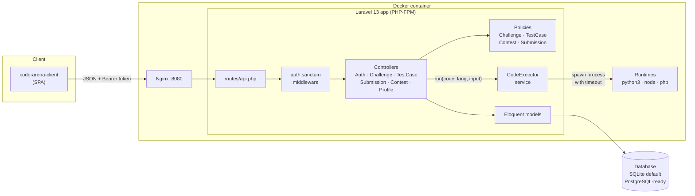
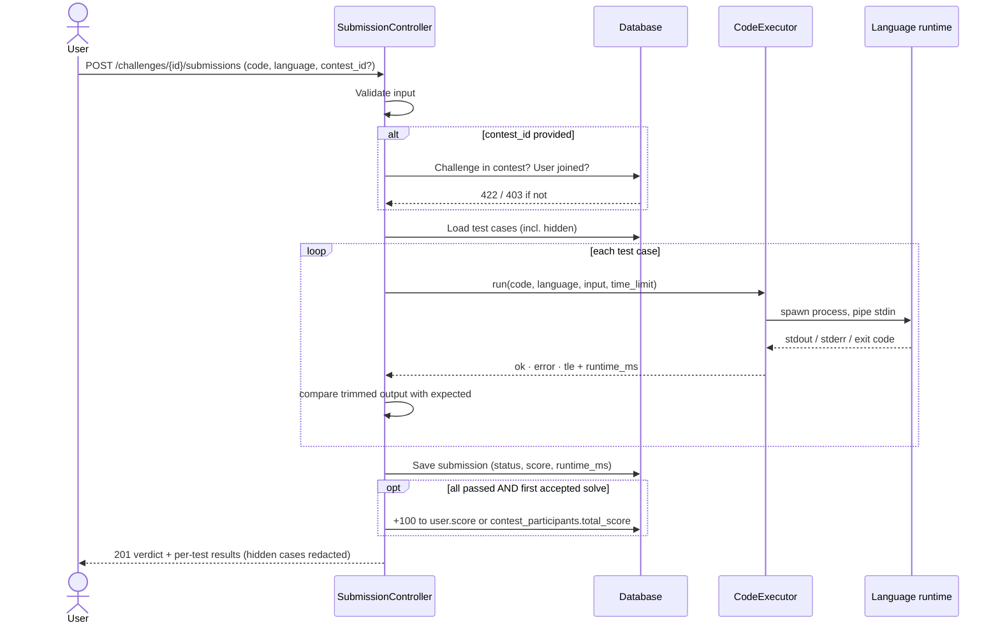
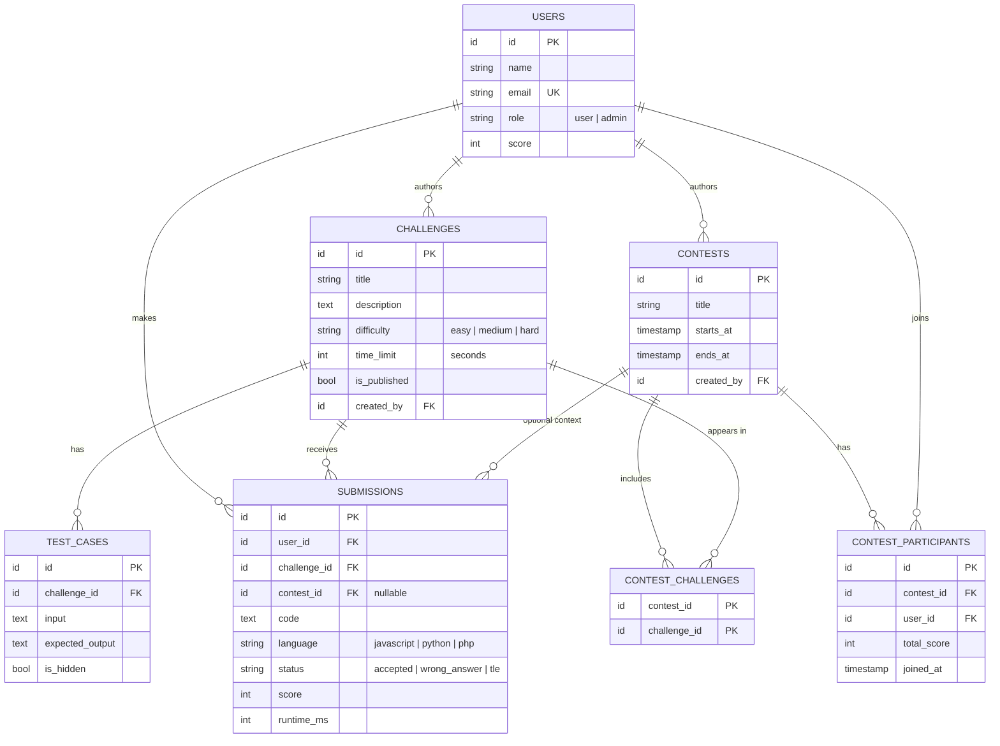

# ⚔️ CodeArena API

**A self-hostable competitive-coding backend: solve challenges, get judged against test cases, and climb live contest leaderboards.**


CodeArena is a REST API in the spirit of LeetCode / Codeforces. Admins author challenges and hidden test cases, users submit code in **JavaScript, Python or PHP**, and the server executes it against every test case and returns an instant verdict. Timed **contests** add a per-contest leaderboard.

> 🖥️ **Frontend:** [MaghanDas/code-arena-client](https://github.com/MaghanDas/code-arena-client)
> 📄 **Design document:** [`CodeArena_documentation.pdf`](./CodeArena_documentation.pdf)

---

## ✨ Features

- **Token auth** with Laravel Sanctum (register / login / logout)
- **Role-based access** – `user` (competitor) and `admin` (author) enforced through Laravel Policies
- **Challenge library** with difficulty filter (`easy` · `medium` · `hard`), per-challenge time limit and publish flag
- **Test cases** with **hidden** cases whose input/expected output are never leaked in verdicts
- **Judge engine** – runs submitted code per test case with a timeout and returns `accepted`, `wrong_answer`, `tle` or a runtime error
- **Contests** – start/end window, join flow, challenge set, and a ranked leaderboard
- **Scoring** – 100 points for the first accepted solve of a challenge (global score, or contest score when submitted inside a contest)
- **Submission history** per user, plus admin user/role management

---

## 🏗️ Architecture

### System overview



### Submission and judging flow



### Data model



---

## 🧰 Tech stack

| Layer | Technology |
|---|---|
| Framework | Laravel 13, PHP 8.4 |
| Auth | Laravel Sanctum (bearer tokens), Policies |
| Database | SQLite (default), PostgreSQL driver included (`pdo_pgsql`) |
| Queue / cache | Database drivers |
| Judge | `symfony/process` executing `python3`, `node`, `php` |
| Serving | Nginx + PHP-FPM, Supervisor config, multi-stage Dockerfile |
| Testing | PHPUnit |

---

## 🚀 Getting started

### Prerequisites
PHP ≥ 8.4, Composer 2, and (for the judge) `python3` and `node` on your `PATH`.

### Local setup

```bash
git clone https://github.com/MaghanDas/code-arena-api.git
cd code-arena-api

composer install
cp .env.example .env
php artisan key:generate

touch database/database.sqlite      # default DB_CONNECTION=sqlite
php artisan migrate --seed

php artisan serve                   # http://localhost:8000
```

Set `FRONTEND_URLS` in `.env` to your client origin (default `http://localhost:5173`) so CORS allows it.

### Docker

```bash
cp .env.example .env
docker compose up --build           # API on http://localhost:8000
docker compose exec laravel php artisan migrate --seed
```

### Seeded accounts

| Role | Email | Password |
|---|---|---|
| Admin | `admin@codearena.com` | `password` |
| User | `alice@codearena.com` | `password` |
| User | `bob@codearena.com` | `password` |

> ⚠️ Change or remove these before deploying anywhere public.

### Tests

```bash
php artisan test
```

---

## 📡 API reference

Base path: `/api` · Authenticated routes need `Authorization: Bearer <token>`.

### Public

| Method | Endpoint | Description |
|---|---|---|
| POST | `/register` | Create an account |
| POST | `/login` | Obtain an API token |
| GET | `/challenges` | List challenges (`?difficulty=easy\|medium\|hard`) |
| GET | `/challenges/{id}` | Challenge details |
| GET | `/contests` | List contests |
| GET | `/contests/{id}` | Contest details |
| GET | `/contests/{id}/leaderboard` | Ranked participants |

### Authenticated

| Method | Endpoint | Description |
|---|---|---|
| POST | `/logout` | Revoke current token |
| GET | `/user` | Current user |
| GET / PATCH | `/profile` | View / update own profile |
| POST | `/challenges/{id}/submissions` | Submit code (`code`, `language`, optional `contest_id`) |
| GET | `/submissions` | Own submission history |
| GET / DELETE | `/submissions/{id}` | View / delete a submission (policy-guarded) |
| POST | `/contests/{id}/join` | Join a contest (`409` if already joined) |

### Admin

| Method | Endpoint | Description |
|---|---|---|
| POST / PATCH / DELETE | `/challenges`, `/challenges/{id}` | Manage challenges |
| GET / POST | `/challenges/{id}/test-cases` | List / add test cases |
| PATCH / DELETE | `/test-cases/{id}` | Edit / remove a test case |
| POST / PATCH / DELETE | `/contests`, `/contests/{id}` | Manage contests |
| GET | `/users` | List users |
| PATCH | `/users/{id}/role` | Change a user's role |

### Example: submit a solution

```bash
curl -X POST http://localhost:8000/api/challenges/1/submissions \
  -H "Authorization: Bearer $TOKEN" \
  -H "Content-Type: application/json" \
  -d '{"language":"python","code":"print(sum(map(int,input().split())))"}'
```

```json
{
  "status": "accepted",
  "score": 100,
  "runtime_ms": 84,
  "error": null,
  "results": [
    { "test_case_id": 1, "passed": true, "is_hidden": false, "input": "1 2", "expected": "3", "got": "3" },
    { "test_case_id": 2, "passed": true, "is_hidden": true,  "input": null,  "expected": null, "got": null }
  ]
}
```

---

## 🔐 Security notes

The judge executes user-submitted code **directly on the application host**, with a timeout as the only limit. Before exposing this publicly, run the executor in an isolated sandbox (per-run containers, gVisor/Firecracker, or an external judge such as Judge0) with CPU, memory, filesystem and network restrictions.

---

## 🗺️ Roadmap

- [ ] Sandboxed code execution
- [ ] Queue-based asynchronous judging (queue driver already configured)
- [ ] Solve-time tiebreaks and penalties on the leaderboard
- [ ] Partial scoring per test case
- [ ] More languages (Java, C++, Go)

---

## 👤 Author

**Maghan Das** – [@MaghanDas](https://github.com/MaghanDas)
